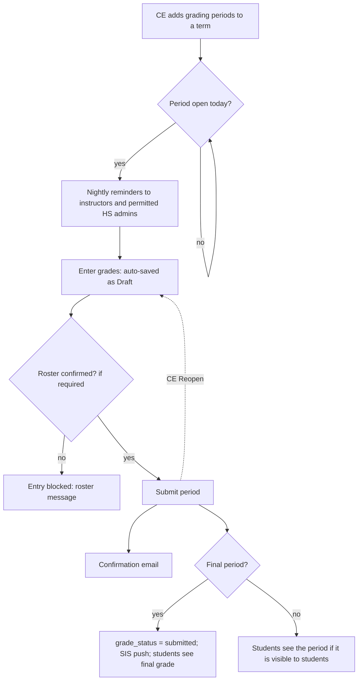

# Grades guide (v1.3.0)

How the `grades` package works:
- grading periods and the grade-entry workflow;
- who can enter grades;
- what each portal shows (CE, instructor, high school admin, student);
- the settings, the scheduled command, the emails and the reports;
- the extension points tenants use.

Install and wiring steps are in the [README](../README.md#install-into-a-tenant). The change list for each release is in [CHANGELOG.md](../CHANGELOG.md).

## Overview

Grades are collected per **grading period**. A term can have interim periods (for example "Mid-Semester Grades 1") and one **final** period. For each period and class:
- the primary instructor and, with permission, the school's high school admins enter grades during the period's window and submit them;
- CE can follow progress, edit on someone's behalf, reopen a period and push final grades to the SIS;
- students see a period's grades once their class has submitted it, if the period allows it.

**Where grades live**

| Grade | Stored on | Sent to the SIS |
|---|---|---|
| Interim (mid-semester) marks | `PeriodGrade`, one per student per period, with change history (only actual changes, with who made them) | No |
| Final grade | `StudentRegistration.grade` (cis), with change history | Yes |

**Submission state:**
- `SectionPeriodStatus` holds the state per class and grading period: Not Started (`''`), Draft (`saved`) or Submitted (`submitted`).
- The final period's state is mirrored onto `ClassSection.grade_status`. The SIS push, `StudentRegistration.submitted_grade` and older CE pages read that field.

`grades` depends on `cis`; `cis` never imports `grades`. The few cis features that need a grade fact go through `cis/integrations/grades.py`, which returns safe defaults when the package is absent.

---

## 1. Lifecycle



1. **Set up.** CE adds the term's grading periods (section 2) and fills in the Class Grades Settings (section 8).
2. **Open.** From *Opens On* to *Due On* (inclusive), the period is open. The instructor and permitted HS admins can enter grades. The reminder job emails anyone who hasn't submitted yet (section 9).
3. **Draft.** The grid auto-saves as grades are typed (status Draft). **Save as Draft** saves explicitly.
4. **Submit.** Grades must be filled in for every student, and the roster must be confirmed if the setting requires it. Submitting locks the period for the instructor and HS admins and sends the confirmation email (section 10).
5. **Final period.**
   - The class's `grade_status` becomes `submitted`.
   - The final grades can be pushed to the SIS (section 12).
   - Students see their final grade.
6. **Change after submit.** CE **Edit** changes grades in place, and the period stays submitted. CE **Reopen** sets the period back to Draft so it can be entered again while still open.

---

## 2. Grading periods

Grading periods belong to a **term**. They decide when grades can be entered, when reminders go out and when students see grades. The settings hold no grade dates.

**Where:** CE → Terms → *term* → **Grading Periods** tab (add, edit, delete). URL names: `grades_ce:add_grading_period`, `grades_ce:edit_grading_period`, `grades_ce:delete_grading_period`.

| Field | Meaning |
|---|---|
| Name | Shown everywhere (for example "Mid-Semester Grades 1", "Final Grades"). Unique within the term. |
| Sequence | Order within the term, for grid columns and reports. |
| Opens On / Due On | Grades can be entered from *Opens On* through *Due On*. *Due On* can't be before *Opens On*. |
| Final Grade Collection | The final period. It writes the registration grade sent to the SIS. At most one per term. |
| Reminder Frequency (days) | Re-email people who haven't submitted, every N days while the period is open. 0 = off. |
| Remind Days Before Due | One extra reminder this many days before *Due On*. 0 = off. |
| Visible to Students | Students see this period's grades once their class has submitted them. |

**Rules** (in `services/periods.py`):

- Periods on one term can't overlap.
- A class follows **its own term's** periods. A class on a sub-term (for example "Fall 2026 - First Half Term") doesn't inherit the parent term's periods. Give the sub-term its own periods if its classes need grades.
- A term with no grading periods has no grade entry. Pages show "No grading periods are set up for this class's term."
- A period is **editable** (`is_period_editable`) when three things hold:
  - it's open today;
  - it isn't submitted yet;
  - the roster gate passes (section 3).

  CE can edit any period at any time.
- On a multi-campus host each campus has its own terms, so each campus sets up its own periods.

---

## 3. Who can enter grades

| Who | Sees | Enters and submits |
|---|---|---|
| **Primary instructor** (`section.teacher`) | Their classes' grades | Yes, while the period is editable. |
| **Secondary instructor** (cis#154) | The class, but no grades, no Grades row and no grade page | No |
| **HS admin**, any position at a school on the class | The Grades tab and grade page, read-only. Can also download the grades CSV, the roster PDF and Grades by Grading Period. | Only with *Can submit grades* (below). |
| **HS admin with *Can submit grades*** | As above, editable | Yes, while the period is editable. |
| **Secondary-school HS admin** (cis#154) | Only their own school's students | With *Can submit grades*: saves a draft for their students. They can't submit the class's period; the instructor or the primary school does. |
| **CE** | Every class on the campuses they may edit | Edits any period at any time (no auto-save), and reopens periods. |
| **Student** | Their own grades, if the settings and the period allow | No |

**The *Can submit grades* rule** (v1.3.0, #16):

An HS admin can enter and submit grades for a class when they have an **Active** position at a school on the class. That means the primary school, or a secondary school per cis#154. The position must hold **Can submit grades** (`HSAdminPerm.SUBMIT_GRADES`) for the course's campus. A grant with no campus counts on every campus.

The check is `services/gating.hs_admin_can_submit_grades(user, section)`. Every HS admin page and POST uses it, including the autosave request.

- CE grants the permission on the admin's position at the high school.
- The setting page shows how many active positions hold it (section 8).
- On a cis that can't grant per-school permissions (before 0.1.15a), **no** HS admin enters grades. They see them read-only.
- Before v1.3.0 the "High School Admin Grade Access" setting (none / view / edit) decided this. It was removed: a stored value is ignored and dropped on the next save.

**Roster gate:** with *Require roster confirmation before grades are entered* on, nobody, instructor or HS admin, can enter grades while the class's roster is **Pending Verification** (`services/gating.can_enter_grades`). Classes already reported as Accurate or Inaccurate, and classes never sent for verification, aren't blocked. See the cis roster verification guide.

---

## 4. CE staff

| Where | URL name | What |
|---|---|---|
| **Terms → term → Grading Periods** tab | (term tab) | Set up periods (section 2). |
| **Class Sections → Grades** tab | (sections tab) | Per-period progress for the selected term (submitted / draft / not started / % complete), and the final-grade distribution. Has a term switcher. |
| **Class Section → Grades** tab | (class tab) | The class's grid, one column per period, read-only. The card header carries each period's status, its dates, **Edit** and **Reopen**, beside **Download Roster** and **Download Grades** (CSV). |
| **Edit** | `grades_ce:class_section_grade` | Edits one period on someone's behalf: any period, any time, no auto-save. Saving a submitted period keeps it submitted and sends no confirmation. Every save adds a **class note** naming the staff member and listing each change (`Last, First: B → A`). |
| **Reopen** | `grades_ce:reopen_period` | Sets a submitted period back to Draft so it can be entered again while open. Adds a class note. |
| **Grades → Summary** | `grades_ce:summary` (`/ce/grades/summary/`) | For one grading period: each instructor's classes as Submitted / Draft / Not Started, with status and last reminder. Can filter by high school and download as CSV. **Remind** emails one instructor, or everyone who hasn't submitted (`grades_ce:summary_remind`). Shows only the CE user's campuses. |
| **Grades → SIS** | `grades_ce:sis_sync` (`/ce/grades/sis/`) | Final grades pushed to the SIS, per class and per registration, with push actions (section 12). Registration pages get a **Grade SIS** tab. |
| **Reports** | | Section 11. |
| **Settings → Class Grades Settings** | | Section 8. |

CE grade pages open only for classes on campuses the CE user may edit.

---

## 5. Instructors

| Where | URL name | What |
|---|---|---|
| **Dashboard** | | A page message while a grading period is open for their classes (`page_messages.instructor_dashboard`). |
| **Class Grades** (menu) | `instructor:grades` (`/instructor/grades/`) | Their classes in the current grade terms, with a term switcher ("All current terms" by default).<br>Columns: Term, Course, CRN, High School, Students (count by registration status), Grades Status (each period's status, with open periods marked), Manage/Edit.<br>Page messages and the *Grades Intro* show above the list. |
| **Grade page** (Manage/Edit) | `instructor:class_section_grade` | The Class Details layout with two tabs, **Grades** (open) and **Notes**.<br>The grid has one column per period; only the open, unsubmitted period is editable.<br>Actions: **Save as Draft** (auto-saves as you go), **Submit**, **Download Roster** (PDF), **Download Grades** (CSV). |
| **Class Details → Grades** tab | (instructor tab registry) | The same grid inside the class page. Shown only when the term has grading periods, and only to the primary instructor. |

Instructors can only open their own classes; any other class gives a 404 (PT-32).

---

## 6. High school admins

| Where | URL name | What |
|---|---|---|
| **Dashboard** | | A page message per open grading period, shown only to admins who can submit grades for some of their classes (`page_messages.hs_admin_dashboard`). |
| **Class page → Grades** tab | (highschool_admin tab registry) | The shared grid, editable only with *Can submit grades* (section 3). The *HS Admin Grades Intro* (or the *Grades Intro* when blank) shows above it. |
| **Grade page** | `grades_highschool_admin:class_section_grade` (`/highschool_admin/grades/class_section/<id>`) | The same grid in a Details layout, with **Download Roster** and **Download Grades**. A POST from an admin without the permission returns 404. |
| **Reports → Grades by Grading Period** | | Limited to their schools that are Active at the class's campus (section 11). |

Classes at schools they don't administer return 404.

---

## 7. Students

| Where | URL name | What |
|---|---|---|
| **My Courses** (menu) | `student:grades` (`/student/grades/`) | Their registrations. The columns are chosen in the settings: Term, Course / Section No., Tuition, Status, Grades. The Grades column shows:<br>• the final grade, once the class has submitted it;<br>• each period marked *Visible to students*, once submitted.<br>The table loads from `student:grades_rows`. |
| **Unofficial transcript** | `student:download_transcript` | A PDF built from the transcript templates in the settings. |

Both can be turned off in the settings: *Students Can See Their Grades* and *Students Can Download the Unofficial Transcript*.

---

## 8. Settings: Class Grades Settings

CE → Settings → **Class Grades Settings**:
- Configurator key `<CAMPUS_CODE_PREFIX>_class_grades`.
- File: `settings/class_section_grades.py`.
- One per campus on a multi-campus host.
- It holds no term or date values; those are on the grading periods.

The page groups its fields under headers (v1.3.0). `from_db()` fills in any key a saved row is missing, and `install()` seeds the defaults.

**General**

| Setting (key) | Default | What it does |
|---|---|---|
| Send Grades Emails (`is_active`) | Yes | The switch for every grades email: Yes, Debug (send only to the debug list) or No. With Django `DEBUG` on, Yes acts as Debug. |
| Debug Email List (`debug_email_list`) | | The addresses that get grades emails in Debug mode. |
| Grade Scale (`grade_scale`) | A–F | The grades that can be chosen, with their GPA points. Also sets the grade columns in the distribution reports. |
| Registration Status(es) (`registration_status`) | | Which registrations appear on the grade grid. |

**Roster Confirmation**

| Setting | What it does |
|---|---|
| Require roster confirmation before grades are entered (`require_roster_confirmation`) | Blocks entry while the roster is Pending Verification (section 3). |
| Roster Not Confirmed Message (`roster_not_confirmed_message`) | Shown on the grid while entry is blocked. |

**Grades-Due Reminders**

| Setting | What it does |
|---|---|
| Send Grades-Due Reminders (`send_grade_reminders`) | Turns the reminder job on or off (section 9). |
| When should the notification be sent? (`cron`) | The CronTab for `notify_period_grades_pending` (Min Hr Day Month WeekDay). Required while reminders are on. |
| Grades Due Email Subject / Message (`grades_due_subject`, `grades_due_email`) | The instructor reminder. Merge fields: `{{teacher_first_name}}`, `{{teacher_last_name}}`, `{{term}}`, `{{number_of_sections_pending_grades}}`, `{{grading_period}}`, `{{due_date}}`. |

**High School Admins**

The group opens with a note that explains the *Can submit grades* rule and shows how many active positions hold the permission on this campus. It shows a warning when none do, or when the installed cis can't grant it.

| Setting | What it does |
|---|---|
| HS Admin Grades Due Email Subject / Message (`hsadmin_grades_due_subject`, `hsadmin_grades_due_email`) | The reminder that admins holding *Can submit grades* always get with the grades-due reminders. Required. A blank saved value uses the default; there is no off switch. Merge fields: `{{admin_first_name}}`, `{{admin_last_name}}`, `{{term}}`, `{{number_of_sections_pending_grades}}`, `{{grading_period}}`, `{{due_date}}`. |
| HS Admin Grades Intro (`hsadmin_grades_intro`) | Shown above the grades on the HS admin Grades tab and grade page. Blank uses *Grades Intro*. |

**Grade Pages**

| Setting | Where it shows |
|---|---|
| Grades Intro (`grades_intro`) | Above the instructor Grades list, and for HS admins when their intro is blank. |
| Grade Entry Instructions (`grades_open_class_section`) | Above the grade roster, for instructors and HS admins, while grades aren't yet submitted. |
| Grades Submitted Message (`grades_submitted_class_section`) | Above the grade roster once submitted. |

**Grades Submitted Email**

| Setting | What it does |
|---|---|
| Send a Confirmation When Grades Are Submitted (`notify_instructor_on_submit`) | Yes: each period's submission is confirmed to the submitter, the primary instructor and the permitted primary-school HS admins (section 10). No: only the Copy To list. |
| Grades Submitted - Copy To (`grades_submitted_cc`) | Addresses (comma-separated) copied on every confirmation, even when the confirmation is off. |
| Grades Submitted - Email Subject / Email (`grades_submitted_email_subject`, `grades_submitted_email`) | The confirmation. Merge fields: `{{submitter_first_name}}`, `{{submitter_last_name}}`, `{{instructor_first_name}}`, `{{instructor_last_name}}`, `{{grading_period}}`, `{{term}}`, `{{course}}`, `{{class_number}}`. |

**Students** and **Transcript**

| Setting | What it does |
|---|---|
| Students Can See Their Grades (`student_grades_visible`) | When off, a notice shows instead of the grades table, and the rows feed is empty. |
| Students Can Download the Unofficial Transcript (`student_transcript_enabled`) | When off, the button is hidden and the download returns 404. |
| Student Grades Table Columns (`student_grade_columns`) | The student table's columns. A column left unchecked isn't sent to the browser. |
| Transcript Header / Table Header / Row Template / Footer | HTML templates for the transcript PDF. Merge fields include `{{student_name}}`, `{{student_id}}`, `{{highschool}}`, `{{generated_date}}`, and per row `{{term}}`, `{{course_name}}`, `{{course_title}}`, `{{teacher}}`, `{{credit_hours}}`, `{{grade}}`. |
| Transcript Registration Status(es) (`transcript_registration_status`) | Which registrations appear on the transcript. |

**Retired keys:**
- In v1.0.0, every date setting (`terms`, `start_date`, `end_date`, `reminder_dates`, `grades_open`, `grades_closed`, `viewable_from_date`, `viewable_end_date`). These moved to grading periods.
- In v1.3.0, `hs_admin_grade_entry`.

`from_db()` drops them (`RETIRED_KEYS`).

---

## 9. Commands and reminders

| Command | Schedule | What it does |
|---|---|---|
| `notify_period_grades_pending` | CronTab row of the same name. Saving the setting with reminders on sets its cron. | Sends the grades-due reminders (`services/period_reminders.py`). |
| `notify_grades_pending` | none | Retired in v1.0.0. It does nothing, and its CronTab row can be deleted. |

**Who gets reminded, per open period:**
- the **primary instructor** of every active class (status `A`) on the period's own term that hasn't submitted;
- **HS admins whose Active position holds *Can submit grades*** at the class's primary or secondary school, for the course's campus.

Each person gets one email per period, covering all their classes. Someone who is both a class's instructor and an admin gets the instructor email.

**When a class is reminded:**
- The period has a reminder frequency or days-before-due set.
- Today is within *Opens On* to *Due On*.
- The class hasn't submitted.
- It hasn't been reminded today.
- Either the frequency has passed since the last reminder (never reminded counts as due), or today is exactly *Remind Days Before Due* days before *Due On*.

Each reminded class gets `last_notified_on` set and a class note ("Sent grades due reminder email for <period>").

**Run it by hand:**

```bash
docker exec -w /app/webapp <container> python manage.py notify_period_grades_pending
```

It does nothing when Send Grades-Due Reminders is No. In Debug mode the emails go to the debug list.

---

## 10. Emails

All grades email goes through `services/email.send_grades_mail`, which applies Send Grades Emails, Debug and the debug list.

| Email | Trigger | Recipients | Settings |
|---|---|---|---|
| Instructor reminder | `notify_period_grades_pending` | Primary instructors with classes due | `grades_due_subject`, `grades_due_email` |
| HS admin reminder | `notify_period_grades_pending` | Admins holding *Can submit grades* | `hsadmin_grades_due_subject`, `hsadmin_grades_due_email` |
| Grades submitted | Any period submitted from a grade page (instructor, HS admin, or CE when CE submits). Re-saving a submitted period doesn't trigger it. | The submitter, the primary instructor, and the primary school's admins holding *Can submit grades*, deduplicated; plus Copy To. Secondary instructors and secondary-school admins are never included. | `notify_instructor_on_submit`, `grades_submitted_cc`, `grades_submitted_email_subject`, `grades_submitted_email` |
| Summary "Remind" | CE clicks Remind on Grades → Summary | The chosen instructor(s) | Same as the instructor reminder |

Before v1.3.0 the grades-submitted email was a `ClassSection` signal. It went to the instructor only, and only for the final period. Setting `grade_status` by any other route (for example the CE class form) no longer sends it.

---

## 11. Reports

All reports run in the background and produce a CSV. On a multi-campus host every report lists and accepts only the current campus's terms and grading periods. Fields marked * are required. They're registered in `apps.py` (`_REPORTS_BASE`); run `register_reports` after an upgrade that adds one.

### Grades by Grading Period (`period_grades`)
*For CE and every HS admin.* One row per student registration, with one column per selected period.

- **Filters:**
  - Term(s)*: a parent/sub-term tree, where a parent includes its sub-terms.
  - Grading Period(s)*: only periods of the selected terms can be picked, and the server also rejects a period from another term.
  - High School(s), Registration Status(es), Period Submission Status.
  - There's no campus field. CE get the campuses they process; HS admins get their own Active schools.
- **Columns:**
  - Term, Course, Class No., Section No.
  - Instructor, Instructor Email, High School
  - Student Last Name, Student First Name, Student ID, Registration Status
  - One column per selected period, holding the mark (blank if none).

### Grade Submission Status by Period (`period_submission_status`)
*For CE.* One row per class per grading period.

- **Filters:**
  - Term(s)*: a tree, where a parent includes its sub-terms.
  - Grading Period(s): follows the terms. Blank means every period.
  - High School(s).
- **Columns:**
  - Term, Course, Grading Period, Final
  - Class No., Section No.
  - Instructor, Instructor Email, High School
  - Status, Status Changed On, Last Reminder

### Grades: Pending Submission Recipients (`pending_submission_recipients`)
*For CE.* New in v1.3.0 (#14). One row per **person** who still owes grades for the chosen periods. It's also a **Bulk Messages data source**.

- **Filters:**
  - Term(s)*, Grading Period(s) (blank means every period).
  - Status: Not Started / Draft (both by default).
  - High School(s).
  - **Recipients:**
    - Instructors (default): the primary instructor of each class.
    - High school admins who can submit grades.
    - Both.
- **Columns:**
  - Role, Last Name, First Name, Email
  - Grading Period(s), Class Count, Classes
  - Statuses (each class and period)
  - Graded, Not Graded: interim periods count the period mark, the final period counts the registration grade.
- **Left out:** classes already submitted, secondary instructors, classes with no instructor or no instructor email (for the instructor part), and admins without the permission.
- **Data source:**
  - In Bulk Messages, pick this report as the recipient list and set the same filters.
  - Merge fields: `{{FirstName}}`, `{{LastName}}`, `{{Role}}`, `{{GradingPeriods}}`, `{{ClassCount}}`, `{{Classes}}`, `{{Statuses}}`, `{{Graded}}`, `{{NotGraded}}`.
  - Each email address appears once.
  - The tenant needs `REPORTS_USE_AS_DATASOURCE_ENABLED = True`.

### Class Grade Status (`class_grade_status`)
*For CE.* One row per class, giving the **final** grade status and how many students are graded.

- **Filters:** Campus*, Term(s)*, Grade Status, High School(s).
- **Columns:**
  - Term Code, Term, Course, Course Title, Class No., Section No.
  - Instructor Last Name, Instructor First Name, Instructor Email, High School
  - Grade Status, Grade Status Changed On
  - Students, Graded, Not Graded

### Grade Distribution by Course / by High School / by Demographics
*For CE.* Counts of each grade, from the final grade or from one chosen grading period.

| Report | Filters | Row columns |
|---|---|---|
| by Course (`grade_by_course`) | Campus*, Term(s)*, Course(s), High School(s), Registration Status(es)*, Grading Period | Course, Stream, Credit Hours, Total Enrolled |
| by High School (`grade_by_highschool`) | Term(s)*, High School(s), Registration Status(es)*, Grading Period | High School, District, Total Enrolled |
| by Demographics (`grade_by_demographics`) | Campus*, Term(s)*, Group By*, High School(s), Course(s), Registration Status(es)*, Grading Period | the group value, Total Enrolled |

Each distribution report then adds:
- one count column per grade in the Grade Scale, plus W;
- the same grades as percentages;
- Success Rate (A, B and C), DFW Rate (D, F and W), and Avg GPA.

A blank Grading Period means the final grade. Total Enrolled counts every selected registration.

---

## 12. SIS grade push

The final grades of submitted classes can be pushed to the SIS. EWU pushes them to Banner as student-unverified-grades through Ethos.
- `GradeSISSync` holds one row per registration: Queued, Sent, Failed or Needs Mirroring.
- A sent grade that changes later is flagged Needs Mirroring by `signals.flag_grade_change`.
- CE works from Grades → SIS and the registration's Grade SIS tab.
- `grades` never imports `ethos`. The pusher comes from the tenant.

Setup and the pusher contract are in the [README](../README.md#sis-grade-push) and the host doc `docs/grades-and-sis-grade-push.md`.

---

## 13. Extension points

| Hook | Where | Use |
|---|---|---|
| Grade grid student columns | Tenant `services/grades_columns.py` → `columns(builtin, default_keys)` returning `services.columns.Column` objects | Add or reorder roster columns. The built-in keys are `last_name`, `first_name`, `psid` and `highschool`. For example, Lamar adds High School. |
| Page messages | `grades/page_messages.py` (`@page_message(portal, page)`) | The open-period messages on the instructor Grades page and dashboard, and the HS admin dashboard. Tenants can register more providers for the same pages. |
| Tabs | `tabs.py`, `instructor_tabs.py` | Registered against the cis, instructor and highschool_admin tab registries. A host without a registry simply gets no tab. |
| Permission checks | `services/gating.py` | `hs_admin_can_submit_grades(user, section)`, `submit_grades_positions(campus)`, `submit_grades_admins_lookup()`, `can_enter_grades(section)`. |
| Older cis | `compat.py` | Feature detection for the campus gate, the term tree, secondary sections and tenant overrides. |

Deprecated in v1.3.0, to be removed in a later release: `gating.hs_admin_grade_access()`, `hs_admin_can_view_grades()` and `hs_admin_grade_entry_enabled()`.

---

## 14. Common changes

**A. Add a mid-term period.** Go to Terms → term → Grading Periods → Add. Give it a name, a sequence before the final, *Opens On* / *Due On*, and a reminder frequency. Tick *Visible to Students* if students should see it.

**B. Let HS admins enter grades.**
1. Grant **Can submit grades** on the admin's position at the high school, for all campuses or the course's campus.
2. Check the count in the settings' High School Admins group.

The admin gets the editable grid, the dashboard message and the reminders.

**C. Add a roster column.** Ship `services/grades_columns.py` in the tenant's `myce_tenant_configs` with `columns(builtin, default_keys)`. For example, return `[builtin[k] for k in default_keys] + [builtin['highschool']]`.

**D. Remind people who haven't submitted.**
- Reminders go out automatically while the period is open.
- For a custom message, use Bulk Messages with the **Grades: Pending Submission Recipients** data source, filtered to the period, Not Started and Draft.
- Grades → Summary → Remind re-sends the standard reminder.

**E. Let someone fix grades after submit.** Use CE **Edit** to change them on someone's behalf (the period stays submitted), or **Reopen** so the instructor or admin can re-enter them while the period is open.

**F. Hide grades from students.** Untick the period's *Visible to Students*, or turn off *Students Can See Their Grades* for everything.

---

## 15. Upgrade notes

| Version | What changed for tenants |
|---|---|
| v1.0.0 | Grading periods replace the setting's dates. Migration `0005` turns the old window into a Final Grades period. Delete the `notify_grades_pending` cron. |
| v1.1.0 | HS admins with *Can submit grades* get their own reminder. |
| v1.2.0 | Secondary teachers and schools (cis#154). Secondary-school admins grade only their own students. |
| v1.3.0 | *Can submit grades* alone decides HS admin entry; the access setting is gone. Every HS admin sees grades. Confirmation on every period. HS admin intro. Pending Submission Recipients report. Run `register_reports`, then open and save Class Grades Settings once. Grant the permission where HS admins should enter grades. HS admin entry needs cis 0.1.15a or later. |

The full lists are in [CHANGELOG.md](../CHANGELOG.md) and the GitHub releases of `Canusia/package-grades`.

---

## Key files

| File | Purpose |
|---|---|
| `grades/models.py` | `GradingPeriod`, `PeriodGrade`, `SectionPeriodStatus`, `GradeSISSync` |
| `grades/services/periods.py` | Open / editable / submitted rules, `set_status`, routing marks to `PeriodGrade` or the registration |
| `grades/services/gating.py` | Roster gate, *Can submit grades* checks |
| `grades/services/grade_grid.py` | The shared grid (columns, rows, editable period, messages) |
| `grades/views/grade_entry.py` | The shared grade POST (draft, autosave, submit, confirmation) |
| `grades/views/instructor.py`, `views/hs_admin.py`, `views/ce.py`, `views/student.py` | Portal views |
| `grades/services/period_reminders.py` | The reminder job |
| `grades/services/submitted_email.py` | The grades-submitted confirmation |
| `grades/settings/class_section_grades.py` | The settings configurator |
| `grades/reports/` | Reports (section 11) |
| `grades/page_messages.py`, `tabs.py`, `instructor_tabs.py`, `menu.py` | Portal integration |
| `grades/compat.py` | Compatibility with older cis |

## Tests

Tests live in `grades/tests/` and run with `python manage.py test grades.grades.tests` (editable submodule) or `grades.tests` (pip).

| Area | Modules |
|---|---|
| Periods and entry | `test_grading_periods`, `test_v1_grading_period_rules`, `test_period_grade_entry`, `test_v1_period_services`, `test_grade_entry_autosave_sort` |
| HS admins | `test_hs_admin_period_entry`, `test_v1_hs_admin`, `test_secondary_sections` |
| Reminders and emails | `test_period_reminders`, `test_period_reminders_hs_admin`, `test_v1_reminders`, `test_submitted_email` |
| Settings | `test_settings_gaps`, `test_v1_settings`, `test_settings_install`, `test_settings_preview`, `test_grade_scale_setting` |
| Reports | `test_v1_reports`, `test_report_class_grade_status`, `test_pending_submission_recipients`, `test_report_*_campus` |
| Pages and portals | `test_v1_instructor_pages`, `test_v1_instructor_list`, `test_v1_page_messages`, `test_v1_ce_class_tab`, `test_v1_student_visibility` |
| SIS | `test_sis_*` |

## Troubleshooting

| Symptom | Cause | Fix |
|---|---|---|
| "No grading periods are set up" | The class's **own** term has no periods. | Add periods to that term, not only the parent. |
| Instructor can't edit | The period isn't open today, is already submitted, or the roster is pending (when required). | Check the dates; use CE Reopen or Edit; confirm the roster. |
| HS admin sees grades but can't edit | Their position at the school doesn't hold *Can submit grades* for the course's campus, the position isn't Active, or cis is older than 0.1.15a. | Grant the permission on the position; upgrade cis. |
| HS admin gets no reminders | As above, or the admin's account is inactive or has no valid email. | Same as above. |
| HS admin sees no Grades tab | The class's school isn't one of theirs. | Check their positions. |
| Report: "Choose grading periods of the selected term(s) only" | A period from another term is selected. | Pick the term first; periods of other terms are greyed out. |
| No reminders | Send Grades-Due Reminders is No, the cron isn't set, or the period has neither a reminder frequency nor days-before-due. | Fix the setting or the period. |
| No confirmation email | Send Grades Emails is No or Debug, Send a Confirmation is No (only Copy To gets it), or the period was already submitted (a CE re-save). | Check the settings. |
| Student sees no interim grade | The period isn't *Visible to Students*, or the class hasn't submitted it. | Tick the box; submit. |
